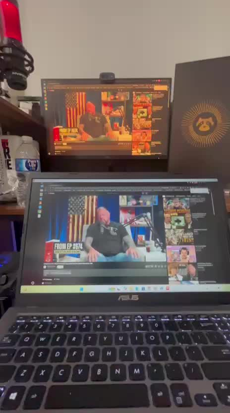

# Secure Remote Access & Wake-on-LAN Home Lab

By Freddy Flores · Progress recorded November 20–21, 2026

**Status: in progress. Desktop control and local wake from suspend work; an always-on home wake relay remains to be configured.**

## My home lab, from my laptop

I wanted to keep working on my cybersecurity labs when I’m away from my desk. This project connects my Windows laptop to my Ubuntu desktop so I can use the desktop’s applications and reach the environment where I run my lab VMs.

I built the setup with **Tailscale for private connectivity**, **NoMachine for desktop control**, and **Wake-on-LAN for waking the wired desktop**. Getting connected was only part of the work: I also tested display behavior, audio, and whether wake settings survived a reboot.

<figure><figcaption>My laptop and desktop during the remote-session test. This photo shows the working display connection; it does not by itself prove an off-network connection.</figcaption></figure>

## What works—and what is still pending

| Check | Result |
| --- | --- |
| Ubuntu wired adapter supports magic-packet wake | Verified with ethtool |
| Wake settings survive a restart | Verified in NetworkManager and on the adapter |
| Wake from suspend on home Wi-Fi | Passed: the Windows laptop woke Ubuntu |
| NoMachine desktop control | Working after initial blank-screen troubleshooting |
| Multiple monitors and desktop audio | Working in my follow-up test |
| Wake from a phone hotspot | Did not work with the local broadcast command |
| Unattended wake from outside home | Pending an always-on laptop at home |
| Wake from full shutdown | Separate verification still needed |

## How the connection fits together

**Current remote-access path:** Windows laptop → Tailscale private connection → Ubuntu desktop → NoMachine session.

**Planned remote-wake path:** Windows laptop → Tailscale → always-on laptop at home → local wake packet → Ubuntu starts → NoMachine connection.

The desktop uses wired Ethernet. Tailscale makes the running computers privately reachable without exposing NoMachine’s desktop service through a router port-forward. It cannot receive a request on a computer that is asleep or powered off. That distinction became the main lesson of the hotspot test.

## Making wake settings persistent

The adapter initially reported `Wake-on: d`, meaning waking was disabled. I enabled magic-packet wake on `enp3s0`, then saved it in Netplan and explicitly set the NetworkManager connection profile to `magic`.

Applying Netplan produced a network-service reload warning. I checked the active services and confirmed Ethernet remained connected through NetworkManager. I then checked the profile rather than assuming the saved configuration had taken effect.

After restarting, these checks still returned the expected values:

```bash
nmcli -g 802-3-ethernet.wake-on-lan connection show "netplan-enp3s0"
# magic

sudo ethtool enp3s0 | grep -i wake
# Supports Wake-on: pumbg
# Wake-on: g
```

These are transcribed verification results from my lab notes. I kept the original configuration screenshots privately because they also contain device and network identifiers.

On Windows, I created a reusable `Send-DesktopWake` PowerShell function. It builds the magic packet from the desktop’s Ethernet MAC address and sends it over UDP to the home subnet’s broadcast address. I suspended Ubuntu, sent the packet from my laptop on home Wi-Fi, and watched the desktop resume. A “packet sent” message alone would not have proved the wake succeeded.

## Troubleshooting the remote session

My first NoMachine connection reached Ubuntu but stopped at a license error. Activating the Personal Edition evaluation let me continue; this setup currently uses a trial, so ongoing use requires a licensing decision.

Next, the laptop showed a blank screen while Ubuntu reported an active viewer. I investigated screen-sharing and display settings rather than assuming Tailscale had failed. Earlier session logs showed Wayland capture errors; later logs showed successful capture and hardware encoding. I eventually confirmed desktop control, monitor switching, and audio were working. I have not established a single proven cause for the initial delay.

<figure><video controls playsinline preload="none" poster="assets/remote-session.jpg" style="width:100%;max-height:560px"><source src="assets/remote-control-demo.mp4" type="video/mp4">Watch the <a href="assets/remote-control-demo.mp4">remote-control demonstration</a>.</video><figcaption>A short recording from my working session, showing interaction from the laptop and the corresponding desktop display. This published excerpt is silent; audio functionality is recorded in the test results above.</figcaption></figure>

## Why the hotspot wake test failed

Changing the laptop to my phone’s hotspot moved it off the home network. My PowerShell function still sent a local broadcast wake packet, so it could no longer reach the sleeping desktop at home. Installing Tailscale on the desktop did not solve this: the desktop’s software is not running while it is off or asleep.

I checked my Verizon CR1000A router’s documented capabilities and did not find a built-in wake sender to use for this setup. The next step is to keep a spare laptop powered at home, connect it to Tailscale, and use it to send the local wake packet on request. The spare laptop still needs a charger.

## The remaining milestone

**Set up the always-on home laptop as the wake relay.** Then I’ll repeat the test from cellular data: wake Ubuntu, wait for Tailscale to reconnect, open NoMachine, and access a lab VM. I’ll test suspend and full shutdown separately and record the result of each. I’m not marking end-to-end remote power-on complete until that test passes.

For the portfolio, I selected demonstration footage rather than publishing every raw recording. Earlier blank-screen clips and screenshots with authentication links remain in my private troubleshooting evidence. Credentials, license keys, and personal network details do not belong in the public write-up.

## References

- [Tailscale: building a remote Wake-on-LAN setup](https://tailscale.com/blog/wake-on-lan-tailscale-upsnap)
- [NoMachine: switching between remote monitors](https://www.nomachine.com/support/documents/switching-the-view-between-multi-monitors-during-a-remote-desktop-session)
- [NoMachine Player configuration guide](https://kb.nomachine.com/DT07X00338)
- [Verizon CR1000A router guide](https://www.verizon.com/content/dam/verizon/support/consumer/documents/internet/verizon-router-guide.pdf)

## Supporting notes

- [Evidence review](docs/evidence-review.md)
- [Security and next tests](docs/security-and-next-tests.md)
