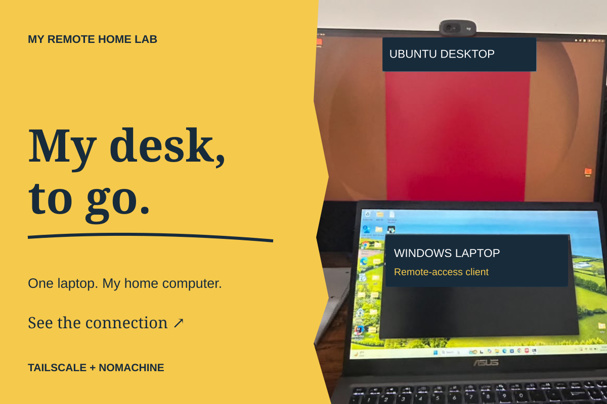
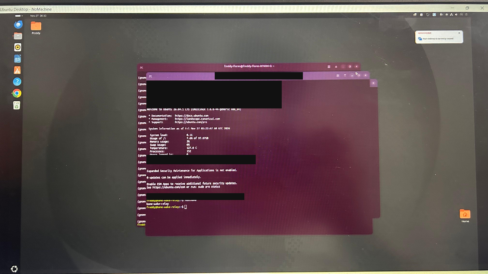
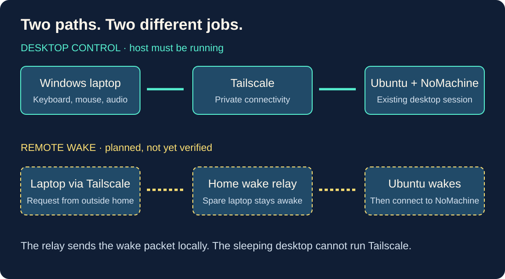

# Secure Remote Access & Wake-on-LAN Home Lab

By Freddy Flores · November 20–27, 2026

**Core lab complete: remote wake from suspend and desktop access verified over an iPhone cellular hotspot.**

## Outcome

I can wake my home Ubuntu desktop from a Windows laptop outside my home network, then use its existing desktop session through NoMachine. An HP laptop stays awake at home and sends the local Wake-on-LAN packet. The final test used my iPhone hotspot with cellular data, and I confirmed the desktop woke and NoMachine connected.

*Redacted photograph of the final NoMachine session. The cellular connection and successful wake are my recorded test observations; the photograph alone cannot establish the network path or prior power state.*

## Architecture

1. The Windows client connects to the HP relay through Tailscale and ordinary OpenSSH.
2. The relay sends a magic packet over the home LAN to the desktop’s Ethernet adapter.
3. The desktop resumes from suspend and becomes reachable through Tailscale.
4. NoMachine connects to the desktop and displays the existing session.

The relay uses home Wi-Fi; the target desktop uses Ethernet. No router port-forward was added for this lab. Tailscale on a sleeping desktop cannot receive a remote wake request, so the awake relay supplies that missing step. This setup does not use Tailscale SSH, an exit node, or subnet routing.

## Equipment and roles

| Component | Role |
| --- | --- |
| Windows laptop | Remote client: SSH, Tailscale and NoMachine |
| Ubuntu 26.04.1 desktop, Intel i5-14400F | Wired wake target and host for my lab applications/VMs |
| HP EliteBook 840 G3, i5-6300U, 8 GB RAM, approximately 256 GB SSD | Ubuntu Server 26.04.1 relay, named `home-wake-relay` |
| 16 GB Kingston USB | Ubuntu Server installation media |
| Home router and iPhone cellular hotspot | Home LAN and independent off-network test connection |

## Verified results

| Test | Result and evidence |
| --- | --- |
| Ethernet magic-packet support | `ethtool` showed support; wake changed from `d` to `g` |
| Persistence after desktop reboot | NetworkManager reported `magic`; adapter reported `Wake-on: g` |
| Local wake from suspend | Passed from Windows on home Wi-Fi and later from the HP relay |
| Ubuntu Server installation | Completed; Wi-Fi, SSH and updates verified |
| Relay recovery after reboot | SSH reconnected and hostname/uptime checks passed |
| Lid behavior | External-power ignore policy saved; SSH remained available during the lid-test workflow. Screenshot alone does not show lid position |
| Private SSH to relay | Passed over the relay’s Tailscale address |
| Cellular hotspot → relay → wake → NoMachine | **Passed, confirmed November 27** |
| Multiple displays and audio | Confirmed in earlier NoMachine testing; not separately remeasured in the final hotspot run |
| Wake from full shutdown | Not tested; not required for the completed suspend-wake goal |
| SSH keys / MFA / least-privilege policy and firewall review | Follow-up work, not claimed complete |

## Build and troubleshooting

I enabled magic-packet wake on the desktop and saved it in Netplan and the NetworkManager profile. A Netplan reload warning required checking the active network services and the adapter afterward. Reboot verification established that the wake setting persisted.

The first direct wake attempt from a phone hotspot failed: a local broadcast from that network could not reach my home LAN. Repurposing the HP as a relay solved this. I installed Ubuntu Server from USB, selected the internal Samsung SSD with a 100 GB root LVM volume, connected Wi-Fi, and enabled OpenSSH. I checked the SSH host fingerprint on the physical laptop before accepting it remotely.

After updating the relay and installing `wakeonlan`, I restored suspend on the desktop by unmasking `sleep.target` and `suspend.target`. Hibernate targets were left unchanged. I configured the relay to ignore lid closure on external power, rebooted it, and verified SSH access. Tailscale then provided private access to the relay from the Windows client on cellular data.

Two other issues were investigated:

- **Startup login refusal:** a temporary `pam_nologin` message cleared after boot completed.
- **127°C banner reading:** `lm-sensors` showed CPU cores around 40–42°C while ACPI `temp6` reported 127°C. The laptop did not feel hot. The ACPI reading is suspect; its root cause and overall hardware health were not established.

NoMachine initially required Personal Edition evaluation activation. A subsequent blank-screen issue was investigated through display/sharing settings and capture logs; later desktop control, monitor switching and audio worked. No single cause for the blank screen was proven. Continued use still requires checking the installed edition’s licensing terms.

## Why NoMachine

My goal was to return to the same physical Ubuntu desktop, including open terminals and VM consoles. NoMachine supports physical Wayland desktops. A typical xrdp/xorgxrdp deployment provides a separate Xorg remote session, which is useful for a dedicated remote workspace but differs from this lab’s goal. Both can be reached over Tailscale; NoMachine is not the source of the private network protection.

## Evidence and reproduction

- [Complete gallery: all 18 screenshots from the lab folder](docs/evidence-review.md)
- [Configuration walkthrough and operating procedure](docs/configuration-walkthrough.md)
- [Security boundaries and optional next tests](docs/security-and-next-tests.md)
- [Portfolio handoff](docs/portfolio-handoff.md)
- [Earlier silent remote-control demonstration](assets/remote-control-demo.mp4)

Published screenshots are actual captures with opaque redactions, reduced resolution where appropriate, and metadata removed. Hardware identifiers, network addresses, Wi-Fi names, account emails and authentication URLs are excluded. Original files remain private and unchanged. No AI-generated screenshots or fabricated test output are used.

## Scope and limitations

This is a completed functional home lab, not a security audit or a claim of production hardening. Password-based SSH was used; SSH keys were discussed but not configured. Tailscale identity/account protection, device permissions, firewall reachability and NoMachine licensing still deserve review. Power loss, full-shutdown wake, prolonged unattended operation and automatic recovery were not validated. The relay must remain powered, awake and connected; the desktop must retain power and its wired network connection.

Turning the relay into a router is a separate future project.

## References

- [Tailscale: Wake-on-LAN through a home relay](https://tailscale.com/blog/wake-on-lan-tailscale-upsnap)
- [Tailscale: ordinary SSH over Tailscale](https://tailscale.com/docs/reference/ssh-over-tailscale)
- [systemd lid and idle behavior](https://www.freedesktop.org/software/systemd/man/latest/logind.conf.html)
- [NoMachine physical Wayland desktops](https://kb.nomachine.com/AR02P00969)
- [xrdp project documentation](https://github.com/neutrinolabs/xrdp)
