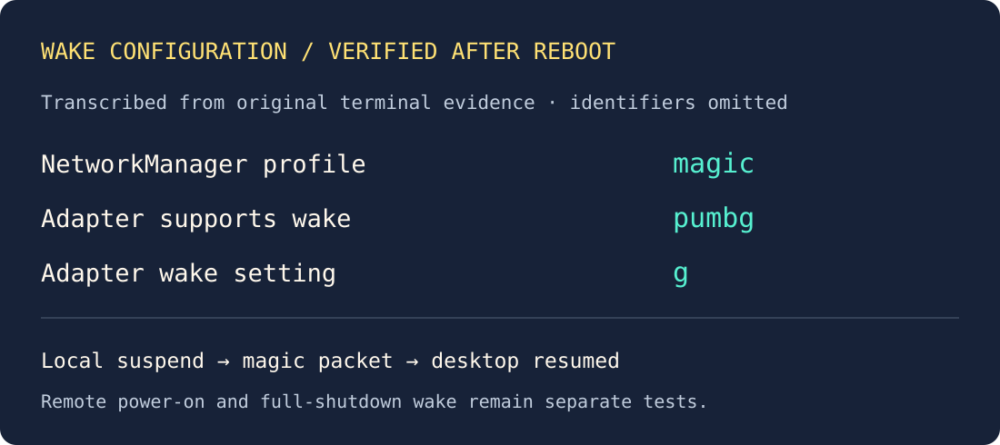

# Configuration walkthrough and interpretation

This records the completed work, with private values omitted. Interface and connection names are specific to this lab; inspect your own configuration before making changes.

## 1. Check the host

Ubuntu 26.04.1, Wayland desktop, wired Ethernet. The Windows laptop is the client. Lab VMs remain on the Ubuntu host.

```bash
cat /etc/os-release
echo "$XDG_SESSION_TYPE"
sudo ethtool enp3s0
```

`Supports Wake-on: pumbg` included magic-packet support. `Wake-on: d` showed it was disabled initially.

## 2. Enable and persist wake

```bash
sudo ethtool -s enp3s0 wol g
sudo netplan set ethernets.enp3s0.wakeonlan=true
sudo netplan generate
sudo netplan apply
```

Applying network configuration can interrupt connectivity. This lab produced a systemd-networkd reload warning, so I checked the active connection instead of assuming success.

```bash
systemctl is-active NetworkManager systemd-networkd
nmcli -f GENERAL.STATE,GENERAL.CONNECTION device show enp3s0
sudo nmcli connection modify "netplan-enp3s0" 802-3-ethernet.wake-on-lan magic
```

After reboot, the profile returned `magic` and ethtool returned `Wake-on: g`.



## 3. Local wake test

The Windows PowerShell function constructed a standard magic packet: six FF bytes followed by sixteen repetitions of the target Ethernet MAC. It sent the packet over UDP port 9 to the local subnet broadcast address. Real MAC and broadcast values are intentionally not included here.

I saved work, stopped running lab VMs, suspended Ubuntu, waited approximately 30 seconds, and invoked `Send-DesktopWake` from Windows on home Wi-Fi. Ubuntu resumed. This confirms suspend wake only; it does not establish full-shutdown wake or internet reachability.

## 4. Desktop connection

Tailscale was installed and authenticated on both computers. NoMachine Personal Edition ran on Ubuntu and Player on Windows. The client used the Ubuntu Tailscale address with NX port 4000, then authenticated with the Ubuntu system account. The server required evaluation activation before the session could start.

## 5. Troubleshooting and verification

- License error: reached the server; resolved by activating the evaluation.
- Blank screen: examined sharing/display behavior and capture logs; later session captured correctly. No single cause is claimed proven.
- Monitors: checked individual remote displays and the combined view.
- Audio: checked NoMachine audio and Windows output settings; user confirmed working.
- Hotspot wake: failed because the local broadcast sender was no longer on the home network.


## 6. Next implementation

Power a spare laptop at home, install/configure private access to it, prevent suspend, and let it send the wake packet locally. The spare laptop currently needs its charger. Repeat the full hotspot-to-wake-to-desktop sequence, then independently test shutdown wake, lock/reconnect, and VM access. Record timings and failures.
