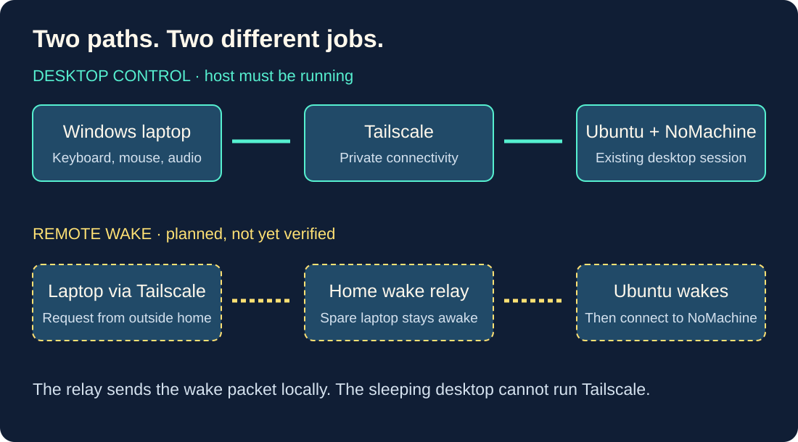

# Configuration walkthrough and interpretation

This records the completed work, with private values omitted. Interface and connection names are specific to this lab; inspect your own configuration before making changes.

## 1. Check the host

Ubuntu 26.04.1, Wayland desktop, wired Ethernet. The Windows laptop is the client. Lab VMs remain on the Ubuntu host.

```bash
cat /etc/os-release
echo "$XDG_SESSION_TYPE"
sudo ethtool enp3s0
```

`Supports Wake-on: pumbg` included magic-packet support. `Wake-on: d` showed it was disabled initially.

## 2. Enable and persist wake

```bash
sudo ethtool -s enp3s0 wol g
sudo netplan set ethernets.enp3s0.wakeonlan=true
sudo netplan generate
sudo netplan apply
```

Applying network configuration can interrupt connectivity. This lab produced a systemd-networkd reload warning, so I checked the active connection instead of assuming success.

```bash
systemctl is-active NetworkManager systemd-networkd
nmcli -f GENERAL.STATE,GENERAL.CONNECTION device show enp3s0
sudo nmcli connection modify "netplan-enp3s0" 802-3-ethernet.wake-on-lan magic
```

After reboot, the profile returned `magic` and ethtool returned `Wake-on: g`.


## 3. Local wake test

The Windows PowerShell function constructed a standard magic packet: six FF bytes followed by sixteen repetitions of the target Ethernet MAC. It sent the packet over UDP port 9 to the local subnet broadcast address. Real MAC and broadcast values are intentionally not included here.

I saved work, stopped running lab VMs, suspended Ubuntu, waited approximately 30 seconds, and invoked `Send-DesktopWake` from Windows on home Wi-Fi. Ubuntu resumed. This confirms suspend wake only; it does not establish full-shutdown wake or internet reachability.

## 4. Desktop connection

Tailscale was installed and authenticated on both computers. NoMachine Personal Edition ran on Ubuntu and Player on Windows. The client used the Ubuntu Tailscale address with NX port 4000, then authenticated with the Ubuntu system account. The server required evaluation activation before the session could start.

## 5. Troubleshooting and verification

- License error: reached the server; resolved by activating the evaluation.
- Blank screen: examined sharing/display behavior and capture logs; later session captured correctly. No single cause is claimed proven.
- Monitors: checked individual remote displays and the combined view.
- Audio: checked NoMachine audio and Windows output settings; user confirmed working.
- Hotspot wake: failed because the local broadcast sender was no longer on the home network.



## 6. Install the HP relay

Back up anything needed before replacing an operating system. In this lab the owner confirmed the old Windows installation contained nothing needed. Write the Ubuntu Server ISO to the 16 GB USB and boot the HP from its UEFI USB entry. Select standard Ubuntu Server, connect Wi-Fi, leave proxy empty and confirm the archive mirror test. Select the **HP internal SSD**, not the USB or another computer’s disk.

The installed layout used LVM: approximately 100 GB root, 2 GB boot and 1 GB EFI, with remaining volume-group capacity unallocated. Disk encryption was not selected to allow unattended startup; physical access therefore remains a consideration. Create the local account and hostname `home-wake-relay`, enable OpenSSH, skip optional featured snaps, complete installation and remove the USB when prompted.

On the relay console, obtain the SSH host fingerprint:

```bash
ssh-keygen -lf /etc/ssh/ssh_host_ed25519_key.pub
```

Compare it with the first connection prompt on the client before accepting. Commands below use placeholders; replace them with your own values, without the angle brackets.

```bash
ssh <RELAY_USER>@<RELAY_LAN_IP>
```

Inside the relay session:

```bash
hostname
whoami
sudo apt update
sudo apt upgrade
sudo apt install lm-sensors wakeonlan
sensors
sudo reboot
```

A disconnect during reboot is expected. Reconnect after startup. In this lab an early `pam_nologin` refusal resolved after waiting; there was no need to bypass login controls.

## 7. Configure lid handling on the relay

Create `/etc/systemd/logind.conf.d/60-wake-relay.conf` with:

```ini
[Login]
HandleLidSwitch=suspend
HandleLidSwitchExternalPower=ignore
HandleLidSwitchDocked=ignore
IdleAction=ignore
```

Use `sudo mkdir -p /etc/systemd/logind.conf.d`, then edit the file with sudo. Reboot and verify the file, hostname and uptime after reconnecting. On external power the policy ignores lid closure; the ordinary battery policy requests suspend, subject to docked handling and other system inhibitors. Keep the relay plugged in with ventilation unobstructed. The saved file and reboot/reconnection are captured in the gallery; the screenshot itself cannot prove physical lid position.

## 8. Restore desktop suspend if disabled

Run these checks on the **desktop**, not the relay:

```bash
hostname
systemctl is-enabled sleep.target suspend.target hibernate.target hybrid-sleep.target
cat /sys/power/state
```

All four targets were masked in this lab, while the kernel listed `freeze mem disk`. To restore only the required suspend path:

```bash
sudo systemctl unmask sleep.target suspend.target
```

After saving work and stopping running lab VMs, use `systemctl suspend`. Hibernate and hybrid-sleep were not enabled by this change.

## 9. Add the relay to Tailscale

Install Tailscale using its [official Linux instructions](https://tailscale.com/docs/install/linux). The lab used the official installation script, then:

```bash
sudo tailscale up
tailscale ip -4
tailscale status
```

Authenticate to the intended tailnet privately. Never publish the authentication URL. From Windows PowerShell with Tailscale connected:

```powershell
ssh <RELAY_USER>@<RELAY_TAILSCALE_IP>
```

Verify the host fingerprint matches the previously verified relay key. This is OpenSSH over Tailscale, not the separate Tailscale SSH feature. No `--ssh`, exit-node or subnet-router configuration was used.

## 10. Complete off-network acceptance test — passed

1. Keep the HP relay awake, plugged in and connected to home Wi-Fi.
2. Connect Windows to an iPhone hotspot using cellular data; disconnect home network links.
3. Establish SSH to the relay’s Tailscale address and check `hostname`.
4. Save desktop work, stop lab VMs cleanly, and suspend the Ethernet-connected desktop.
5. In the Windows-to-relay SSH session, run:

```bash
wakeonlan -i <HOME_SUBNET_BROADCAST> <DESKTOP_ETHERNET_MAC>
```

6. Observe the desktop resume, allow connectivity to return, and connect NoMachine to `<DESKTOP_TAILSCALE_IP>` using the desktop account.

Freddy confirmed the whole sequence succeeded over the iPhone hotspot on November 27, 2026. The final photograph shows NoMachine displaying the Ubuntu desktop. No precise wake latency was measured. The sender’s “packet sent” message is not treated as evidence of actual wake. Full-shutdown wake was not tested.

## Daily use and recovery

From the remote client, connect Tailscale, SSH to the awake relay, send the wake command, then connect NoMachine to the desktop. Leave the relay awake when suspending the desktop. If the relay is unreachable, check its power, Wi-Fi, lid/sleep state and Tailscale status locally. If wake fails, check the desktop’s Ethernet link, power and `Wake-on: g` setting. If the desktop wakes but its GUI fails, diagnose NoMachine separately from the wake path.
